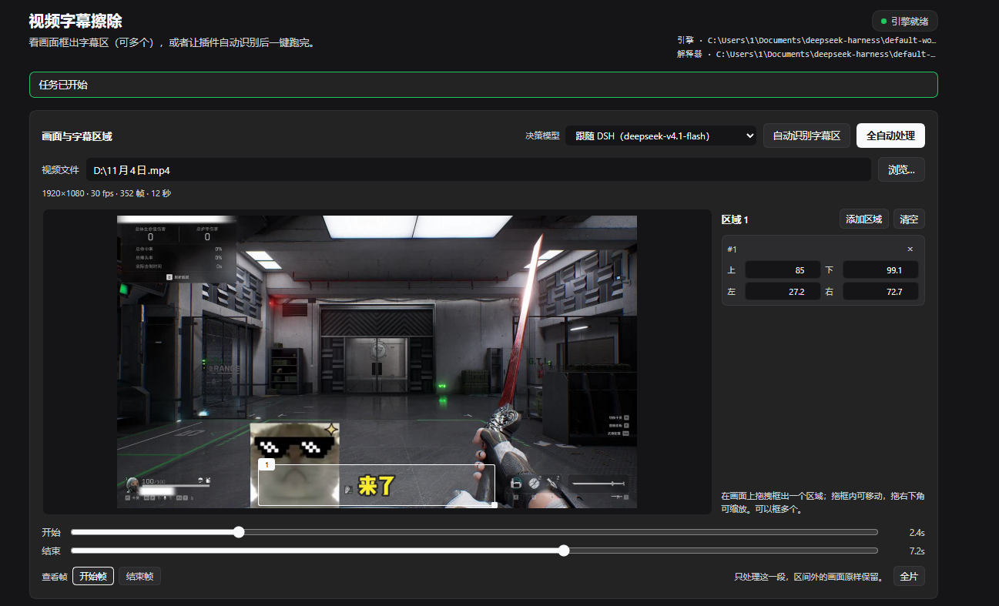
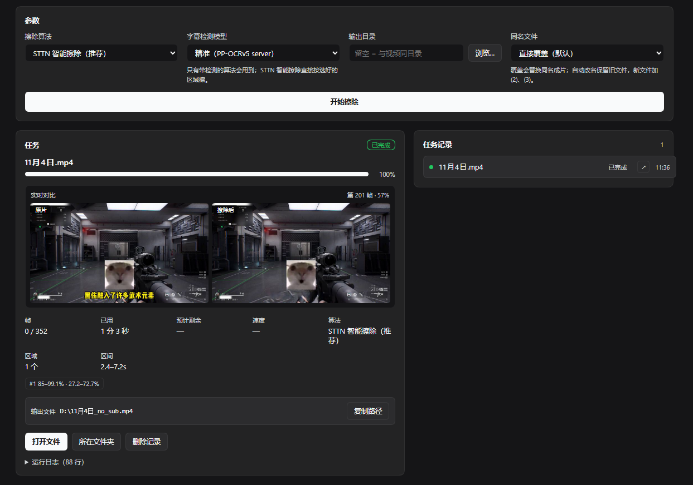

# dsh-subtitle-remover

A DSH Web UI plugin with a left-sidebar entry for
[video-subtitle-remover](https://github.com/YaoFANGUK/video-subtitle-remover):
pick a video, see a frame, mark one or more subtitle regions on it (or let the
engine propose them), then run the job — or the whole automatic path — without
leaving the Harness window.

## Install

1. Get [video-subtitle-remover](https://github.com/YaoFANGUK/video-subtitle-remover)
   working on the same machine: models downloaded, its `config/config.json` in
   place, and a Python environment with torch / paddle / cv2 installed.
2. Clone this repository somewhere stable. Auto-detection covers the two common
   layouts — the engine (`vsr`) and its environment (`vsr-env`) sitting next to
   either the repository or its `plugins/` parent:

   ```
   <dir>/dsh-subtitle-remover        <parent>/plugins/dsh-subtitle-remover
   <dir>/vsr                         <parent>/vsr
   <dir>/vsr-env                     <parent>/vsr-env
   ```
   ```powershell
   cd <dir>          # or <parent>\plugins
   git clone https://github.com/lijianbin2/dsh-subtitle-remover
   ```
   With either layout nothing needs configuring. Any other layout works too — set
   `vsrRoot` / `pythonPath` (see [Configuration](#configuration)).
3. Add it to DSH: on the Plugins page add this folder, or call the plugin
   manager's `install_bundle` with its absolute path.
4. Open the left sidebar entry `字幕擦除` / `Subtitle Remover`.

The engine itself is a separate Apache-2.0 project; this plugin only spawns it and
never bundles its code or models.

## Screenshots

The editor: frame preview with the start/end processing range, drag-drawn regions, and
the detection/model controls.



A finished job: the live before/after comparison strip kept from processing, per-job
metadata with the processing range, and the open-file actions.



## What it adds

- **Sidebar entry** `字幕擦除` / `Subtitle Remover` in the global panel list
  (`sidebar.panellist`), with a small pulse while a job runs.
- **A page** (`main` panel keyed by `subtitle-remover`) with:
  - video path + directory picker (drives, folders, video files, sizes),
  - `ffprobe` readout (resolution, fps, frame count, duration),
  - **frame preview with a start/end time range** and a **region editor**: drag to
    draw a box, drag inside to move it, drag its bottom-right corner to resize; the
    start frame and end frame can both be inspected,
  - **several regions at once** (up to 6), each also editable numerically,
  - **automatic region detection** using the engine's own PP-OCR text detector on
    sampled frames; the proposed boxes land in the same editor, so they stay
    editable,
  - **模型复核**: after detection the plugin can hand the candidate bands and video
    metadata to a DSH chat model (by default the one selected in DSH, switchable
    in the page), which decides which bands are real subtitles and which
    inpainting model to use,
  - **全自动处理 / Run automatically**: detect, let the model decide, then start the
    job in one click,
  - inpainting model + subtitle-detector choice, optional output folder,
  - **处理区间**: only frames between the start and end times are rewritten; the
    rest of the video is copied through untouched,
  - **实时对比预览 / live comparison**: while the job runs, the engine's own preview
    hook writes a throttled before/after JPEG pair, so the page shows the original
    and the cleaned frame side by side, frame number and percent included,
  - live progress, frames, elapsed/remaining, speed, output path + copy,
  - **open-file / show-in-folder** on a finished job, in the job card and in each
    history row,
  - **engine setup inside the page**: a scan of common locations, manual folder and
    interpreter pickers (saved to the plugin, no profile editing), and a one-click
    installer (clone + virtualenv + PyTorch/PaddlePaddle) for machines that don't
    have the engine yet.

## How it talks to the engine

The Host half spawns the runners in `runner/` with the local checkout's
interpreter. Both print one JSON event per line on a private channel
(`@@VSR@@ {...}`) while every engine/tqdm/paddle print goes to stderr:

- `vsr_runner.py` removes subtitles (one `--area` per marked region),
- `vsr_detect.py` samples frames, clusters the detected text boxes into bands and
  reports them as percentages. Bands are ranked by width, horizontal centring and
  frame hits, so HUD text in a corner (ammo counters, kill feeds, minimaps) loses
  against the wide, centred subtitle line.

The page polls these over `/dsh-subtitle-remover/api/*` (registered on the
Harness webServer, same origin, loopback + same-origin checked):

| Route | Purpose |
|---|---|
| `GET /state` | environment verdict, jobs, running detection |
| `GET /jobs`, `GET /jobs/<id>` | job list / one job with its log |
| `POST /jobs`, `POST /jobs/<id>/cancel`, `POST /jobs/<id>/remove` | job lifecycle |
| `GET /browse?path=` | directory listing for the pickers |
| `GET /probe?path=` | video metadata via `ffprobe` |
| `GET /frame?path=&t=` | one JPEG preview frame via `ffmpeg` |
| `GET /jobs/<id>/preview/left\|right` | live before/after comparison frame |
| `POST /jobs/<id>/open` | open the output file or its folder with the OS handler |
| `GET /models` | DSH model catalogue plus the current DSH selection |
| `POST /detect`, `GET /detect/<id>`, `POST /detect/<id>/cancel` | automatic region detection (optionally model-reviewed) |

## Engine setup

Precedence: the folder saved from the page, then the config below, then automatic
detection.

1. **Automatic** — the Host looks next to the plugin, in `~`, `~/Documents`,
   `~/projects`, and the working directory for a checkout of
   video-subtitle-remover with its virtualenv.
2. **Manual** — open `配置引擎` in the page and pick the engine folder (and the
   interpreter if it is somewhere unusual). The choice is stored in
   `<DSH_HOME>/data/dsh-subtitle-remover/settings.json`, so it survives plugin
   upgrades and needs no profile editing.
3. **One-click install** — the same panel can clone the engine and prepare a
   virtualenv with PyTorch / PaddlePaddle (`自动` picks CUDA when an NVIDIA GPU is
   found, otherwise CPU). It needs `git` and Python 3.10+ on `PATH` and downloads
   several GB. Model files are not in the engine repository: install the engine,
   then copy `backend/models` from a video-subtitle-remover release archive (or an
   existing install) into the cloned folder — the panel says exactly which files
   are missing.

## Configuration

All keys are optional; the plugin auto-detects the checkout and its interpreter
first (`<workspace>/vsr`, `<workspace>/vsr-env/Scripts/python.exe`).

```yaml
- id: dsh-subtitle-remover
  name: dsh-subtitle-remover
  config:
    vsrRoot: 'D:\tools\video-subtitle-remover'   # directory containing backend/main.py
    pythonPath: 'D:\tools\vsr-env\Scripts\python.exe'
    ffmpegPath: 'C:\ffmpeg\bin\ffmpeg.exe'       # preview frames; the checkout's bundled copy is used otherwise
    ffprobePath: 'C:\ffmpeg\bin\ffprobe.exe'     # only for the info readout
    defaultDir: 'D:\videos'
    defaultMode: 'sttn-auto'
    defaultDetect: 'server'                      # or 'mobile'
```

## Requirements

- A working video-subtitle-remover checkout (models downloaded, `config/config.json` present).
- Its Python environment (the one with torch/paddle/cv2 installed).
- `ffmpeg` for the preview frame (the checkout ships one, so this normally works
  out of the box) and `ffprobe` for the metadata readout.

## Tests

Two integration checks drive the real Host half through a stub Cordis context and
real engine runs. Each uses its own temp output directory and removes it again.

```powershell
node test/host-api.test.mjs   # routing, gates, browse/probe/frame, detection, model decision, range, preview, open (~5 min)
node test/cancel.test.mjs     # cancel a running job, partial output cleanup (~40 s)
```

`test/fixtures/` holds two tiny synthetic clips; they are test-only and not part
of the shipped `files` list. `host-api.test.mjs` points `DSH_HOME` at a temp folder,
so it never touches the engine settings of the machine that runs it.

## Notes

- The job needs at least one region: draw one, press Detect, or use Run
  automatically. Up to 6 regions per job.
- One job runs at a time (one GPU, one engine); a second request is rejected with
  `409` until the current job finishes or is cancelled.
- Progress granularity follows the engine's batch size, so very short clips can
  jump from 0 to 100 in two steps.
- Automatic detection finds *text-bearing bands* and prefers wide, horizontally
  centred ones; a video whose subtitles are absent in most sampled frames may
  return nothing, so mark the band by hand then.
- The model decision is text-based: the model receives the candidate bands
  (position, width, hit rate), the video metadata and the algorithm menu — not the
  pixels. If the call fails (no key, quota, bad JSON) the heuristic result is kept
  and the page says so.
- The output directory is created only when missing; with the default setting the
  result lands next to the source file (e.g. `D:\clip_no_sub.mp4`).
- **Collision handling**: 「同名文件」 defaults to overwrite; choose auto-rename to
  keep the old file and write `clip_no_sub (2).mp4`, `(3)`, … instead. The job log
  records the rename.
- The processing range maps to the engine's A/B sections: frames outside it are
  written unchanged, so the output keeps the full length.
- Live comparison frames come from the engine's own preview hook (`gui_mode` +
  `update_preview_with_comp`) and are throttled to two JPEGs per ~0.5 s at 640 px.
  Frames outside the processing range are skipped because they would look identical.
- `POST /jobs/<id>/open` uses `explorer.exe` on Windows (`/select,` for the folder),
  `open -R` on macOS and `xdg-open` elsewhere. It only ever opens that job's own
  output path.
- Jobs live in memory: restarting the Host clears the history, never the files.

## Security

The HTTP surface is registered on the GUI's own origin and answers only loopback
requests whose `Host` is loopback and whose `Origin`, when present, matches the
GUI. The image routes (`/frame`, `/jobs/<id>/preview/*`) additionally refuse
cross-site embeds through `Sec-Fetch-Site`, because an `` on another local
page would otherwise be able to display arbitrary local pictures. The
`/jobs/<id>/open` route only ever opens that job's own output path — it never
accepts a caller-supplied path. There is no authentication beyond the desktop
app's own renderer credential gate, so never expose the GUI port to other
machines.

